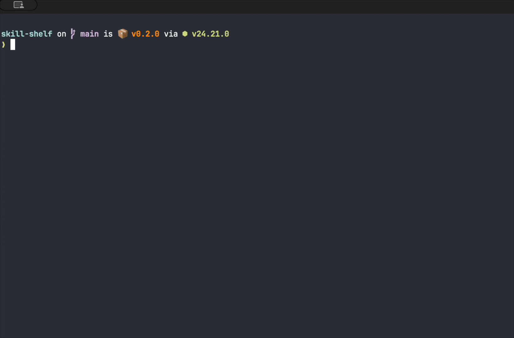

# Skill Shelf

[](https://www.npmjs.com/package/@simonteague6/skill-shelf)
[](https://github.com/simonteague6/skill-shelf/actions/workflows/ci.yml)



Browse your installed agent skills in the terminal, grouped by source across project and global locations.

## Run

Requires Node.js 20 or later and an interactive terminal. Run from the project you want to inspect:

```sh
npx @simonteague6/skill-shelf
```

Or install globally:

```sh
npm install --global @simonteague6/skill-shelf
skill-shelf
```

> [!NOTE]
> Skill Shelf browses skills you already have. It does not install skills, change files, fetch registries, or detect installed agents.

## Browse

- Project opens first and shows supported skill locations in the current directory and its ancestors, nearest first. It stops before your home directory, even above Git roots.
- Global shows your user-wide skills separately.
- Source groups use local lock-file attribution. Skills without a recorded source appear in Your collection.
- Details show recorded sources and installed paths. Duplicate installations collapse within each directory or within Global, not across scopes or project levels.

| Key                              | Action                                 |
| -------------------------------- | -------------------------------------- |
| `Tab`                            | Switch between Project and Global      |
| Arrow keys or `h`/`j`/`k`/`l`    | Select a skill                         |
| `Enter`                          | Open details or return to the overview |
| `Esc`                            | Close details                          |
| Up/down or `j`/`k` in details    | Scroll                                 |
| Left/right or `h`/`l` in details | Browse skills                          |
| `q` or `Ctrl+C`                  | Quit                                   |

Restart to pick up filesystem changes. `--help` and `--version` also work outside an interactive terminal.

## More details

- [Supported locations, discovery rules, and safety limits](https://github.com/simonteague6/skill-shelf/blob/main/docs/compatibility.md)
- [Source setup, tests, and pull requests](https://github.com/simonteague6/skill-shelf/blob/main/CONTRIBUTING.md)
- [Report a bug or suggest a change](https://github.com/simonteague6/skill-shelf/issues/new/choose)
